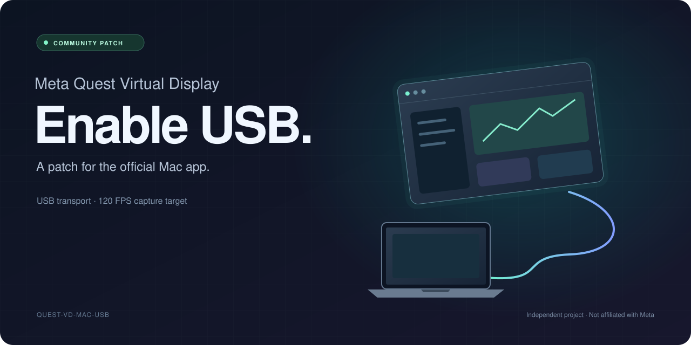

  

# Meta Quest Virtual Display USB

A small patch for Meta’s official Mac app. Enables **USB streaming** and requests **120 FPS** capture and encoding.

Tested on **MacBook Pro M4 + Quest 3**. Delivered 120 Hz isn’t verified. [Measurements →](docs/PERFORMANCE.md)

## Get it

1. **[Fork this repo](https://github.com/andotsy/quest-vd-mac-usb/fork).** Enable Actions in your fork.
2. Open **Actions → Build DMG → Run workflow**. Leave the fields as they are.
3. Download the run’s artifact, unzip it, and open the **DMG**.
4. Run **Install.command**, then open **Meta Quest Virtual Display** from Applications.

Allow Accessibility and Screen Recording, restart when asked, and connect your Quest with a USB data cable.

The Action fetches the latest reviewed Meta build, patches it, and packages everything. Your Mac only copies and signs the app. **No Xcode needed.** An optional Meta DMG URL selects a reviewed version.

Apple Silicon · macOS 13.3+ · Meta’s Quest Virtual Display client

## Next time

**Sync your fork → run Build DMG again.** Existing builds are reused before downloading. Artifacts last 7 days; expired ones rebuild. New Meta versions need compatibility review.

Locally signed, not notarized. If macOS blocks it, use **Privacy & Security → Open Anyway**. [Install & signing](docs/INSTALL.md) · [Build details](docs/MAINTAINING.md)

Independent project. MIT covers our code; Meta’s terms still apply. Public-fork artifacts are downloadable by other signed-in users—use a private copy to restrict access. [Distribution](docs/DISTRIBUTION.md)
